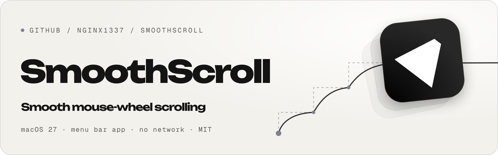

<picture>
  <source media="(prefers-color-scheme: dark)" srcset="docs/banner-dark.png">
  
</picture>

**SmoothScroll** — маленькое приложение для macOS, которое делает прокрутку колёсиком мыши плавной.

Обычно колёсико мыши прокручивает страницу рывками: каждый щелчок — скачок на несколько строк. SmoothScroll превращает каждый щелчок в мягкий ход с замедлением в конце, в такт экрану (60/120 Гц). Приложение живёт в строке меню, без иконки в Dock, а трекпад и Magic Mouse не трогает — у них прокрутка и так плавная.

**Что можно настроить прямо в меню значка:**

- **вкл/выкл** — значок залит, когда прокрутка включена, и показан контуром на паузе;
- **скорость** — сколько пикселей проезжает один щелчок;
- **плавность** — как долго длится ход после щелчка;
- **ускорение** — быстрые щелчки подряд прокручивают дальше;
- **обратное направление** — только для мыши, трекпад не меняется.

⇧ + колёсико прокручивает по горизонтали, как и без приложения. Остальные параметры — в окне **Все настройки…** (⌘,), оно же открывается, если запустить приложение повторно из Finder или Spotlight.


## Сборка

Нужны только Command Line Tools (`xcode-select --install`, Xcode не обязателен), macOS 27 на Apple Silicon.

```bash
git clone https://github.com/nginx1337/SmoothScroll.git
cd SmoothScroll
scripts/build-app.sh            # тесты + release → build/SmoothScroll.app
scripts/test.sh                 # только юнит-тесты ядра
```

Установка: перетащите `build/SmoothScroll.app` в «Программы» и откройте (или `cp -R build/SmoothScroll.app /Applications/`).

При первом запуске macOS попросит доступ: **Системные настройки → Конфиденциальность и безопасность → Универсальный доступ → SmoothScroll**. Без него перехватить колёсико нельзя. Доступ проверяется каждые 2 секунды: после выдачи прокрутка включится сама, а если доступ отозвать, значок в строке меню сразу покажет предупреждение.

## Безопасность и приватность

SmoothScroll не использует сеть и видит только события прокрутки — клавиатура и клики приложению недоступны. Никаких логов, телеметрии и файлов, только настройки в `UserDefaults`. Подробно — в [SECURITY.md](SECURITY.md), там же написано, как сообщить об уязвимости.

## Как устроено

| Часть | Где |
|---|---|
| Логика без UI: анимация хода, точность расстояния, ускорение, пресеты | `Sources/SmoothScrollCore/ScrollAnimator.swift`, `Presets.swift` (+ тесты) |
| Какие события трогать, а какие пропустить как есть | `Sources/SmoothScrollCore/ScrollEventFilter.swift` (+ тесты) |
| Перехват колёсика (`CGEvent.tapCreate`) и отправка плавных событий | `Sources/SmoothScroll/ScrollInterceptor.swift` |
| Строка меню, проверка доступа, значок | `Sources/SmoothScroll/App.swift`, `StatusIcon.swift` |
| Настройки (SwiftUI) и ползунки в меню | `Sources/SmoothScroll/Settings.swift`, `SettingsView.swift`, `MenuSettingsView.swift` |

1. Сессионный event tap ловит события колёсика в отдельном высокоприоритетном потоке, поэтому занятость интерфейса приложения никогда не тормозит прокрутку в системе.
2. Каждый щелчок колеса поглощается и превращается в плавную анимацию (экспоненциальное затухание, ease-out), которую ведёт `CADisplayLink` с частотой обновления экрана.
3. Каждый кадр отправляется маленькое пиксельное событие прокрутки. Остаток долей пикселя переносится между кадрами, поэтому итоговое расстояние точное и не зависит от частоты экрана.
4. Если во время хода курсор уходит в другое окно, ход останавливается: прокручивается только то окно, над которым крутили колёсико. Это можно выключить («Останавливать при переходе в другое окно») — тогда остаток уйдёт в окно под курсором.

**Не трогается** (идёт как есть): трекпад, Magic Mouse и любые устройства с уже плавной прокруткой; прокрутка с зажатыми ⌘ / ⌃ / ⌥ (масштаб и т.п.); собственные события приложения (помечены `eventSourceUserData`).

## Настройки

| Параметр | Значения |
|---|---|
| Плавная прокрутка | вкл/выкл (также прямо в меню) |
| Скорость | 20–200 px за щелчок + пресеты |
| Плавность | 30–300 мс + пресеты |
| Ускорение | вкл/выкл и сила |
| Обратное направление | только для мыши, трекпад не меняется |
| Автозапуск | через `SMAppService` (приложение должно лежать в «Программах») |

Изменения применяются сразу. Внизу окна настроек есть область для проверки прокрутки и кнопка «Сбросить по умолчанию».

## Ограничения

- **Нужен «Универсальный доступ».** Без него macOS не даёт перехватывать колёсико.
- **Подпись — ad-hoc.** Она меняется при каждой пересборке, поэтому после обновления macOS может снова спросить доступ: удалите старую запись «SmoothScroll» из списка «Универсальный доступ» и добавьте заново. Для распространения подпишите Developer ID (`SIGN_ID="Developer ID Application: …" scripts/build-app.sh`) и нотарифицируйте.
- **Только мышь с колёсиком.** Трекпад и Magic Mouse намеренно не трогаются.

## Тесты

```bash
scripts/test.sh
```

25 тестов на ядро (`SmoothScrollCore`):
- анимация: точность расстояния на 30–240 Гц, ease-out, смена направления, ускорение и его предел, ограничение очереди, мусорные входные данные (NaN, отрицательное время), реверс;
- фильтр событий: трекпад/Magic Mouse и ⌘/⌃/⌥ не трогаются, собственные события не перехватываются повторно, склеенные щелчки сохраняют величину (с ограничением), ⇧ + колёсико превращается в горизонтальную прокрутку.

## Иконка

`Resources/AppIcon.icns` генерируется из векторной геометрии, снятой с `Resources/icon-source.png`, поэтому чёткая во всех размерах:

```bash
swift scripts/make-icon.swift
```

## Удаление

Выйти из меню → удалить `/Applications/SmoothScroll.app` → убрать запись из «Универсального доступа» → `defaults delete io.github.nginx1337.smoothscroll`.

## Лицензия

MIT — см. [LICENSE](LICENSE).
